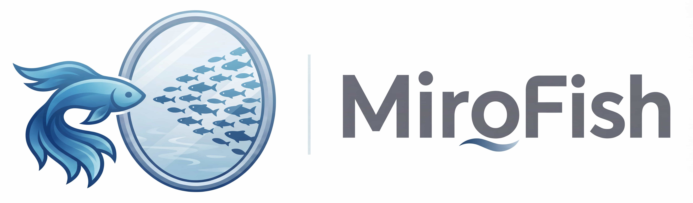

<div align="center">



简洁通用的群体智能引擎，预测万物 —— 可直接使用 DeepSeek API 运行
</br>
<em>A Simple and Universal Swarm Intelligence Engine, Predicting Anything</em>

[English](./README.md) | [中文文档](./README-ZH.md)

</div>

---

## ✨ What's new in this fork

### 1. Direct DeepSeek API — no Zep Cloud, no external graph database

The knowledge graph used to depend on Zep Cloud: a second vendor, a second API key, and a hard
startup failure when that key was missing. It is now **fully local**:

- Extraction runs on **DeepSeek** (`deepseek-chat`) through the plain OpenAI-compatible API
- Graph storage is a **local SQLite file** (`backend/uploads/graphs.db`)
- `ZEP_API_KEY` is **not required** and is no longer part of startup validation
- Any OpenAI-compatible endpoint works — change `LLM_BASE_URL` / `LLM_MODEL_NAME`

### 2. Multi-format document ingest

Seed material is no longer limited to PDF / Markdown / TXT:

| Category | Formats |
|---|---|
| Documents | `.pdf` (text layer, optional OCR for scanned pages), `.docx`, `.pptx`, `.xlsx`, `.xlsm` |
| Text | `.txt`, `.md`, `.markdown`, `.csv` |
| Images | `.png`, `.jpg`, `.jpeg`, `.heic`, `.heif`, `.tiff`, `.tif`, `.bmp`, `.webp`, `.gif` (via OCR) |

- OCR uses the **local macOS Vision framework** — free, offline, no API key
  (`uv sync --extra ocr-macos`), with an optional vision-LLM backend
- Legacy binary Office formats (`.doc` / `.ppt` / `.xls`) are rejected with an explicit
  "save as .docx/.pptx/.xlsx" message instead of failing silently
- Per-file parse results are reported back, so one bad file no longer discards the batch

### 3. Engineering highlights

This fork was audited end to end and rebuilt around verifiable behaviour rather than
"it seems to work":

| Highlight | Detail |
|---|---|
| **Graph de-duplication** | Node identity is now `(graph_id, name)` instead of a fresh `uuid4()` per extraction. Repeated rebuilds used to re-insert every entity — one real database had **9336 node rows for 960 distinct names** (`SAP` alone had 440 copies). A migration script (`scripts/dedupe_graph.py`) repairs existing databases, and rebuilds no longer accumulate |
| **Verifiable offline** | `pytest` went from **0 to 133 tests**, plus a backtest harness (39 checks with a stub driver), a multi-format ingest check (11 cases) and a frontend markdown check (18 cases). All of it runs **without network access and without spending a single LLM call** |
| **Cost guardrails** | Both persona generation and simulation startup estimate their LLM call count first and stop for confirmation when the configured budget is exceeded — instead of silently issuing thousands of calls |
| **Reproducible runs** | Every report carries a run manifest (commit, inputs, model), and reports include a scenario tree rather than a single flat narrative |
| **Robust simulation lifecycle** | A stalled run is detected instead of hanging at "running" forever; orphaned runner processes from a backend restart are reclaimed on startup; stopping a run is no longer reported as a failure |
| **Crash-safe task tracking** | Long-running tasks persist to disk and survive a backend restart, so the UI never spins forever |
| **Safe defaults** | The backend binds `127.0.0.1` by default and CORS allows only the local dev origin |
| **Guarded input handling** | Uploaded chunking parameters are validated (a degenerate `chunk_overlap` used to send a background thread into an unbounded loop), and rendered report content is HTML-escaped before injection |

### 4. Pensieve & Prophecy Orbs — memory and verifiable prophecy layers

Two new artifact-inspired modules sit on top of the existing five-step pipeline:

- **Pensieve (`/pensieve`)** — harvests projects, knowledge graphs, simulations and reports into
  memories (`seed`, `world`, `entity`, `agent`, `episode`, `voice`, `prophecy`, `insight`), links
  them with silver strands (lineage + keyword resonance), replays a memory in a third-person
  scene, and distils several memories into a new insight vial. Reports and finished simulations are
  harvested automatically in the background (once per artifact, never blocking generation), and every
  replay carries clickable citations back to the report chapter or simulation round that produced it.
  Storage: `backend/uploads/pensieve.db`.
- **Prophecy Orbs (`/prophecy`)** — forges a completed report into a sealed orb with prophecy prose,
  confidence, deadline, scenario branches and leading indicators. Open it, scry it, then verify the
  outcome as `fulfilled` / `partial` / `shattered`; verified prophecies flow back into the Pensieve.
  Orbs that are overdue or due within 7 days surface in a reminder bar and a nav badge.
  Storage: `backend/uploads/prophecy.db`.

Both modules are additive — the upload → graph → simulation → report flow is untouched. They appear
in the home nav, the workbench header and the report header. Every LLM call degrades gracefully to a
deterministic local result when the model or key is unavailable.

### 5. Simulation-grounded reports with traceable citations

- **Reports can see the simulation**: the Report Agent now has `simulation_overview` and
  `simulation_search` tools that read `<sim>/<platform>/actions.jsonl` and `*_simulation.db`
  directly, instead of depending on graph write-back.
- **Evidence IDs**: every retrieved post / comment / action carries a `[S1]`-style ID. The report
  page shows an Evidence & Citations panel, and clicking an ID in the prose jumps back to the source.
- **Interviews survive a finished run**: when OASIS has already been torn down, interviews fall back
  to a persona + persisted-behaviour replay, explicitly labelled as replay rather than live.
- **Export**: Markdown, self-contained HTML (print to PDF from the browser) and DOCX.

### 6. Quality, cost and verifiability hardening

| Change | Detail |
|---|---|
| Editable ontology | Add / remove entity and relation types in Step 1; the UI warns when a rebuild is needed |
| Faster extraction | Per-chunk limit 3,000 → 12,000 chars; concurrent extraction (default 4); SQLite `busy_timeout` |
| Persona cache | Same entity + context is generated once and reused across rebuilds / re-runs |
| LLM reliability | Timeout plus exponential-backoff retries wired into the real call path (`retry.py` had zero references before) |
| Round guard | Default 24h (24 rounds); LLM-proposed durations are clamped to at most 72 rounds |
| Cost estimate | Chunk-stage calls are now counted when the graph is not built yet |
| Memory search | Pensieve `LIKE` search upgraded to SQLite FTS5 trigram (falls back to LIKE if unavailable) |
| Prophecy calibration | Brier / log loss / reliability bins; `partial` is not forced into a binary outcome |

### 7. Prediction market and same-origin forks (P1-3)

- **Prediction market (derived layer)**: every simulation maintains a binary LMSR market on
  "will the following result happen within the simulation window: <requirement>". Twitter / Reddit
  posts and comments become YES/NO trades through deterministic stance terms; price, volume,
  snapshots and every trade land in `<sim>/market/market.db`. **No extra LLM calls.** The UI states
  explicitly that this market is driven by community speech, not an independent OASIS trading venue.
  - API: `GET /api/simulation/<id>/market`
  - UI: the run page shows YES/NO price, volume, a price sparkline and recent trades
  - The report outline and evidence overview include the current market state
- **Derived news desk**: high-engagement posts / comments are ranked into headlines
  (`GET /api/simulation/<id>/news`) and shown on the run page and in the report overview.
  It is a scannable aggregate, not an independent news platform.
- **Same-origin forks / A-B comparison**: clone an existing simulation's config and personas into a
  new branch, optionally injecting an event at round N after auto-start.
  - `POST /api/simulation/<source_id>/fork`
  - `GET /api/simulation/<id>/forks` / `GET /api/simulation/<id>/fork`
  - `GET /api/simulation/<id>/compare?other_id=<other_id>` compares action counts, per-platform
    activity, top agents, market YES price and volume
  - UI: a branch form on the run page; a fork can be compared with its parent in one click

> A fork is a rerun from the same initial conditions with a different event injected at round N,
> not an OASIS mid-run state snapshot. It is reproducible and needs no OASIS internals; the cost is
> that the branch spends LLM calls from round 0 again.

### 8. Real-time streams and graph editing (P1-6 / P1-7)

- **Report log SSE**: `GET /api/report/<id>/agent-log/sse?from_line=N` replays existing logs,
  then pushes new entries every second and emits `event: done` on completion/failure.
- **Simulation status SSE**: `GET /api/simulation/<id>/run-status/sse` pushes `run_state` every
  second. The report and run pages prefer `EventSource` and automatically fall back to polling
  when SSE is unavailable (console logs and action details still poll — high volume, low benefit).
- **Graph entity merge**: the node detail panel gains "Merge into another entity"; pick a target
  and confirm. Relations and attributes move into the target, the source is deleted, and duplicate
  edges are collapsed.
  - API: `POST /api/graph/<graph_id>/merge` with `{source_uuid, target_uuid}`
  - Merging is irreversible; the UI says so.

## 🏗 How it works

```
documents ─► ontology ─► knowledge graph ─► personas ─► simulation ─► report ─► chat
             (LLM)        (local SQLite)      (LLM)      (OASIS)      (LLM)
```

| Stage | What happens |
|---|---|
| 1. Ontology | DeepSeek reads the seed material and proposes entity / relation types |
| 2. Graph build | Documents are chunked, entities and relations are extracted, results land in SQLite |
| 3. Personas | Every graph entity becomes an agent with a generated persona |
| 4. Simulation | Agents interact autonomously on simulated Twitter / Reddit; actions are persisted as posts / comments / actions, and the derived prediction market updates live (optional graph write-back) |
| 5. Report | A Report Agent retrieves from both the graph and the persisted simulation evidence, and writes an analysis with `[S#]` citations plus a scenario tree |
| 6. Interaction | Chat with any agent in the simulated world, or with the Report Agent |

**Process model:** Flask (port 5001) serves the API and supervises each simulation as a
**separate child process**; the frontend is a Vite app (port 3000). Mid-run event injection and
agent interviews travel over a file-based IPC channel (`ipc_commands/` / `ipc_responses/`).

**Storage** — everything lives under `backend/uploads/`:

| Data | Location |
|---|---|
| Knowledge graph | `graphs.db` (SQLite) |
| Uploaded files & projects | `projects/` |
| Simulation runs | `simulations/` |
| Reports | `reports/` |
| Runtime settings (contains your key) | `macfish_settings.json` (gitignored) |

## 🚀 Quick Start

### Prerequisites

| Tool | Version | Check |
|---|---|---|
| **Node.js** | 18+ | `node -v` |
| **Python** | ≥3.11, ≤3.12 | `python --version` |
| **uv** | latest | `uv --version` |

> The backend needs Python ≥3.11. If your system Python is older, `uv` can manage 3.12 for you:
> `uv python install 3.12`.

### 1. Configure environment

```bash
cp .env.example .env
# then edit .env and fill in your DeepSeek key
```

```env
LLM_PROVIDER=network
LLM_API_KEY=sk-your_deepseek_api_key
LLM_BASE_URL=https://api.deepseek.com
LLM_MODEL_NAME=deepseek-chat
```

> **No Zep Cloud key required** — the knowledge graph is local SQLite.
> Any OpenAI-compatible provider works; point `LLM_BASE_URL` / `LLM_MODEL_NAME` at it.

### 2. Install dependencies

```bash
npm run setup:all
```

Or step by step: `npm run setup` (Node) and `npm run setup:backend` (Python).

Optional, for local OCR of images and scanned PDFs (macOS only):

```bash
cd backend && uv sync --extra ocr-macos
```

### 3. Start

```bash
npm run dev
```

- Frontend: <http://localhost:3000>
- Backend API: <http://localhost:5001>

Individually: `npm run backend` / `npm run frontend`.

### Docker

```bash
cp .env.example .env
docker compose up -d
```

## 📖 Usage

1. **Create a project** — open <http://localhost:3000>, upload seed documents (see the format
   table above) or paste text, and describe your prediction requirement.
2. **Generate the ontology** — DeepSeek proposes entity and relation types; review and adjust.
3. **Build the knowledge graph** — documents are chunked and extracted into `graphs.db`.
   Rebuilding a graph asks first, because rebuilding replaces the previous one.
4. **Run the simulation** — personas are generated from graph entities, then agents interact
   autonomously on the simulated platforms. You can inject events mid-run.
5. **Generate the report** — the Report Agent retrieves from both the graph and the persisted
   simulation evidence, and writes an analysis with `[S#]` citations plus a scenario tree. Export
   as Markdown / HTML / DOCX; then chat with any agent or with the Report Agent itself.

### Troubleshooting

| Problem | Solution |
|---|---|
| DeepSeek quota exhausted | Point `LLM_BASE_URL` / `LLM_MODEL_NAME` at another OpenAI-compatible provider |
| Poor extraction quality | Refine the entity / relation types during ontology generation |
| Simulation too slow | Lower `OASIS_DEFAULT_TOTAL_HOURS` or `OASIS_MAX_ROUNDS` in `.env` (default 24h / 72-round cap) |
| Simulation stuck at "running" | The runner now detects stalls and reclaims orphaned child processes on startup |
| Entity count looks capped | Graphs larger than the read limit are truncated, and the UI now says so explicitly |
| Reset the graph | Rebuild with "delete and rebuild", or remove `backend/uploads/graphs.db` |

## 🧪 Tests

```bash
cd backend
uv run pytest tests -q                              # 133 tests, offline
uv run python scripts/run_benchmark.py verify       # 39 checks, stub driver
uv run python scripts/test_multi_format.py          # 11 format cases
```

```bash
cd frontend
node scripts/check-markdown.mjs                     # 18 cases
```

None of these touch the network or spend LLM calls.

## 📄 Reference

Forked from **[MiroFish](https://github.com/666ghj/MiroFish)**.
